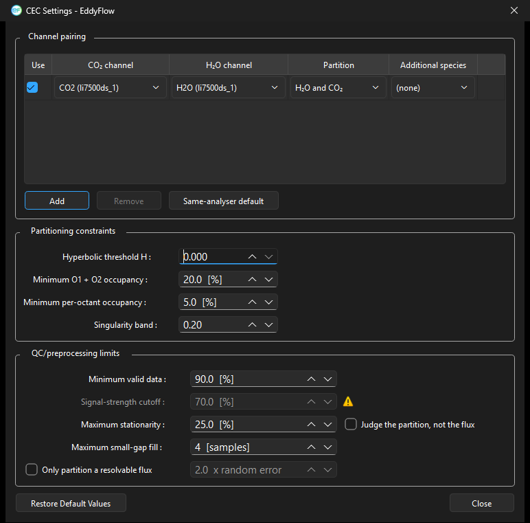

# CEC settings dialog

Under: Advanced Settings > Processing Options > Other options > Conditional Eddy Covariance

Activating **Conditional Eddy Covariance** under **Other options** will cause the **CEC Settings** button to activate. Click on it to open the CEC configuration dialog, where you define which channels are partitioned and the quality conditions a flux averaging period must meet before a partitioned result is reported. For an explanation of the CEC method itself, its output variables, and its assumptions and limitations, see [Conditional Eddy Covariance](conditional-eddy-covariance.md#top). This page documents only the dialog fields.

## Fluxes to partition

The table lists one row per flux to partition. Each row says which flux is split, and which two channels sort the air parcels it is split over. By default it shows water vapor and carbon dioxide for every carbon dioxide channel, each sorted by its own analyzer's channels. Channels are named *species (instrument)*.

- **Flux to partition:** Any gas channel. Water vapor is split into evaporation and transpiration, carbon dioxide into respiration and photosynthesis, and any other gas (for example carbonyl sulfide) into a stomatal and a non-stomatal part. Choosing a flux sets the other two columns to the channels on its own analyzer. If that flux is already in the table with those channels, the row keeps its own water and octant gas, or takes the next combination not yet used, so choosing a flux a second time makes a second version of it.
- **Water channel:** The water vapor channel whose moist updrafts are sorted. *(same analyser)* uses the water vapor channel on the octant gas's analyzer, and keeps doing so if the gas records are reordered.
- **Octants from:** The gas whose sign sorts each moist updraft into stomatal and non-stomatal: carbon dioxide, as published by Zahn et al. (2022), or carbonyl sulfide, marked *experimental*. Carbonyl sulfide octants count soil uptake carried in moist updrafts as stomatal, so use them only where the ground is a net COS source or negligible, and compare them with a carbon dioxide–octant row.
- **Columns end in:** The suffix every output column of this row will carry, for example `_miro_mga4_6_2_cos`. Rows of the same pairing share it, and each version of a gas has its own. Read-only.
- **Warning column:** A warning icon marks a row whose water and octant gas sit on different analyzers. An information icon marks an experimental row: a flux other than water or carbon dioxide, or carbonyl sulfide octants. A note under the table appears while any row is experimental. Hover over a cell for the columns its flux produces and how to read them.
- **Add:** Add a row for the first channel not yet partitioned, carbonyl sulfide first, with the water and octant gas on its own analyzer. Once every channel has a row, Add offers a second version of one instead.
- **Duplicate:** Partition the selected row's flux a second way: the same gas with the next octant gas not yet used for it, then the next water channel, the flux's own analyzer first. Duplicating a carbonyl sulfide row sorted by carbon dioxide octants gives the same flux sorted by carbonyl sulfide octants.
- **Remove:** Delete the selected row.
- **Same-analyser default:** Fill the table again with water vapor and carbon dioxide for every carbon dioxide channel, each sorted by the channels on its own analyzer.

Rows are sorted alphabetically, by flux, then octant gas, then water channel, and re-sorted after every edit, so every version of one gas sits together. Rows that share an octant gas and a water channel are one *pairing* to the engine, and their output columns share one suffix: the octant gas's analyzer, with `_cos` added for carbonyl sulfide octants and, where two pairings would otherwise share it, `_h2o_` and the water's analyzer (see [Splitting one gas several ways](conditional-eddy-covariance.md#splitting-one-gas-several-ways)). Pairings are saved in a fixed order, by octant gas and then water. The engine runs at most 8 pairings and at most 4 fluxes per pairing besides its own water and octant gas; an edit that would exceed this, or that partitions the same flux twice in the same octants, is refused with the reason. See [Conditional Eddy Covariance](conditional-eddy-covariance.md#interpreting-the-results) for how to read the results of each kind of row.

## Partitioning constraints

- **Hyperbolic threshold H:** Half-width of the hyperbolic exclusion region around the origin of the joint scalar quadrant plot. Samples inside it carry little flux information and are excluded from the conditional averages. A value of zero disables the exclusion.
- **Minimum O1 + O2 occupancy:** Minimum combined share of samples, in percent, that must fall into the two ejection octants used by the partition.
- **Minimum per-octant occupancy:** Minimum share of samples, in percent, required in *each* of those octants individually, so that one octant cannot carry the partition on its own.
- **Singularity band:** Width of the band around the singular solution in which the partition becomes numerically ill-conditioned; results falling inside it are rejected.

## QC/preprocessing limits

- **Minimum valid data:** Minimum percentage of raw records in the averaging period that must survive despiking and the other statistical tests before partitioning is attempted.
- **Signal-strength cutoff:** Minimum instrument signal strength (AGC/RSSI, depending on the analyzer) required for the period to be partitioned. Available only when the project actually carries a signal-strength channel.
- **Maximum stationarity:** Maximum permitted non-stationarity, in percent, above which the period is excluded.
- **Maximum small-gap fill:** Longest run of consecutive missing samples, in samples, that may be filled before the period is rejected.
- **Only partition a resolvable flux:** Restrict partitioning to periods where the flux exceeds its own random error by the stated multiple, so that a flux which cannot be distinguished from its noise is never split. The multiplier is entered alongside as *x random error*.
- **Judge the partition, not the flux:** Apply the non-stationarity test to the partitioned result rather than to the underlying flux, which is an alternative to the criterion originally described by Zahn et al. (2022).

## Dialog buttons

- **Restore Default Values:** Return every field on this dialog to its default.
- **Close:** Close the dialog, keeping the current settings.

!!! note

    **Only partition a resolvable flux** and **Judge the partition, not the flux** were introduced in engine 8.0.0 as refinements to the original Zahn et al. (2022) quality criteria, as was the channel pairing table. Earlier versions partitioned a single fixed carbon dioxide and water vapor pair and offered only the occupancy, valid-data, signal-strength and stationarity limits. Since 8.1.8 the table lists one row per flux, and carbonyl sulfide can sort the octants (experimental); projects using it are saved in project format 5.2.0, which older engines refuse.
