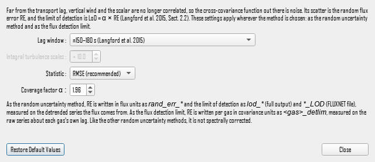

# Limit of detection settings (Langford et al. 2015)

Under: Advanced Settings > Statistical Analysis > Random uncertainty estimation > Settings...

Under: Advanced Settings > Statistical Analysis > Flux Detection Limit > Langford Settings...

This dialog (window title: Limit of detection (Langford et al. 2015)) holds the settings of the limit of detection after [Langford et al. (2015)](references.md#Langford2015). It opens from two places, and both use the same settings:

- **Settings...** beside the **Method** dropdown of the random uncertainty estimation, enabled when the method is **Limit of detection (Langford et al. 2015)** (`ru_meth=6`);
- **Langford Settings...** in the [Flux Detection Limit dialog](flux-detection-limit-settings.md), enabled when its method is **Langford et al. (2015)** (`detlim_meth=2`).

The method, its equations and the meaning of each setting are described under [Random uncertainty estimation](random-uncertainty-estimation.md#far-lag-cross-covariance-and-limit-of-detection-langford-et-al-2015).

## Lag window

**Exact UI label:** Lag window (project-file key `lod_window`, in `[RawProcess_Settings]`; default 0).

Where the cross-covariance function is read for noise, in seconds either side of the lag the flux uses. The two windows, one before and one after the lag, are pooled.

- **±150–180 s (Langford et al. 2015)** (value 0, the default): the far-lag region of [Langford et al. (2015)](references.md#Langford2015), Sect. 2.2.
- **±160–180 s (Maier et al. 2022)** (value 1): the region of [Spirig et al. (2005)](references.md#Spirig2005), used by [Maier et al. (2022)](references.md#Maier2022) for N2O and CH4.
- **Automatic (multiple of the integral turbulence scale, after Spirig et al. 2005)** (value 2): the window starts at the multiple below of the integral turbulence scale, or 10 s beyond the half-width of the variable's time-lag search range, whichever is later, and is 30 s wide. [Spirig et al. (2005)](references.md#Spirig2005) placed their window "several times the integral timescale" from the lag but give no rule; this rule is EddyFlow's own. The integral turbulence scale is computed per period and variable with the **Definition of the ITS** and **Maximum correlation period** of the random uncertainty settings. Where it cannot be measured, the 150–180 s window is used. The window chosen for each variable is written to the run log.

## Integral turbulence scales

**Exact UI label:** Integral turbulence scales (project-file key `lod_its_mult`, in `[RawProcess_Settings]`; default 10; allowed range 1 to 100).

How many integral turbulence scales from the lag the automatic window starts. Used, and enabled, only with the automatic window. The default of 10 is EddyFlow's choice, not a published value.

## Statistic

**Exact UI label:** Statistic (project-file key `lod_stat`, in `[RawProcess_Settings]`; default 0).

- **RMSE (recommended)** (value 0, the default): RERMSE = sqrt(σf² + μf²), the root mean square of the cross-covariance in the windows ([Langford et al., 2015](references.md#Langford2015), Eq. 9). It also counts an offset of the function from zero.
- **Standard deviation** (value 1): RESD = σf, the scatter about the function's own mean in the windows, as in [Wienhold et al. (1994)](references.md#Wienhold1994) and [Spirig et al. (2005)](references.md#Spirig2005). Smaller than the RMSE wherever the function sits off zero.

## Coverage factor α

**Exact UI label:** Coverage factor α (project-file key `lod_alpha`, in `[Project]`; default 1.96; allowed range 1 to 5).

The limit of detection is LoD = α · RE. 1.96 gives the 95 % level, as used by [Langford et al. (2015)](references.md#Langford2015) and [Maier et al. (2022)](references.md#Maier2022); 3 gives about 99 %. It scales only the `lod_*` and `*_LOD` columns of the random uncertainty method: the random error itself, and the flux detection limit `<gas>_detlim`, are not multiplied by it. The random error, and so the LoD, is multiplied by the flux's spectral correction factor when **Spectrally correct the random uncertainty** is checked (off by default, as in EddyPro); see [Spectral correction of the random uncertainty](random-uncertainty-estimation.md#spectral-correction-of-the-random-uncertainty). The flux detection limit is not. It is in `[Project]` because the flux computation module writes the LoD columns as well.

## Dialog buttons

- **Restore Default Values:** ±150–180 s, RMSE, 10 integral turbulence scales and α = 1.96.
- **Close:** Close the dialog, keeping the current settings.

!!! note

    A value the interface does not recognise (a window other than 0 to 2, a statistic other than 0 or 1, or a non-positive multiple or α) is replaced by the default on loading, as the engine does.
