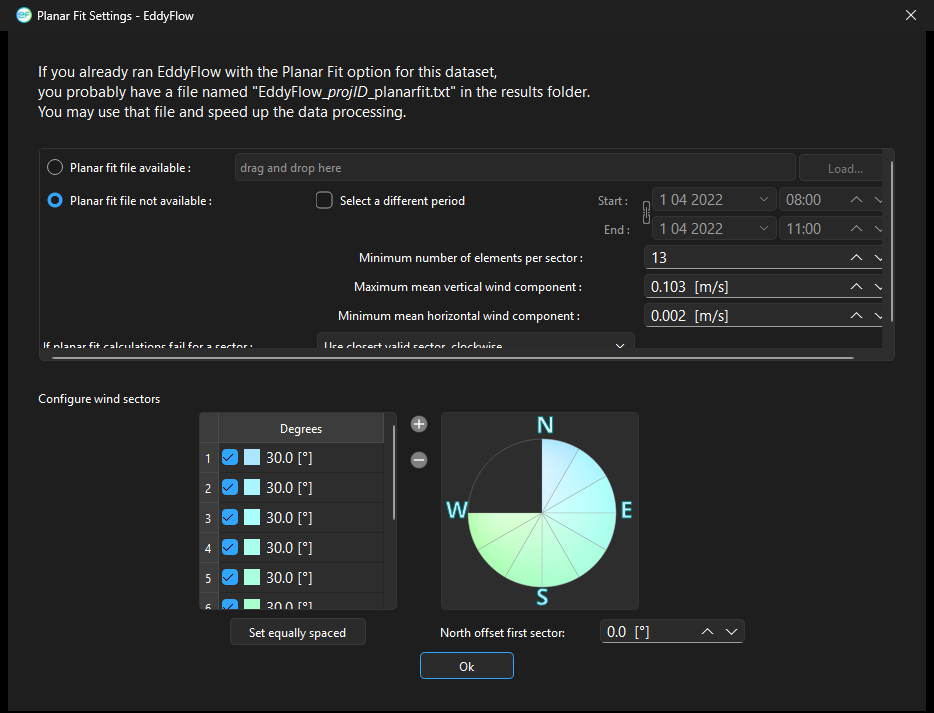

# Planar fit configuration dialog

Under: Advanced Settings > Raw data processing > Rotation Method

Selecting either Planar Fit option (Standard Planar Fit and Planar Fit with no velocity bias) will cause the **Planar Fit Settings** button to activate. Click on it and access the planar fit configuration dialogue. Two options are available here: if you already have a planar fit rotation matrices file created by a previous EddyFlow run, which also applies to your current dataset, select the option **Planar Fit file available** and locate the corresponding file by using the **Load** button (project key `pf_file`; the file browser is titled "Select the Planar Fit File"). Next to **Load** a **Remote drive...** button lets you select the file from a shared Google Drive or Dropbox link, see [Remote folders](remote-folders.md#top). Otherwise, select the option **Planar Fit file not available** and enter the following settings:

## Planar fit different period

- **Start date:** Starting date of the dataset to use for calculating planar fit rotation matrices
- **End date:** Ending date of the dataset to use for calculating planar fit rotation matrices

## Planar fit settings

- **Minimum number of elements per sector:** Set the minimum number of mean wind vectors ("elements") to be used for each sector to assess the fitting plane and calculate the rotation matrix. The higher the number of elements, the more accurate the results, but also the longer the required planar fit subset.
- **Maximum mean vertical wind component:** Setting a maximum vertical wind component will cause EddyFlow to ignore flux averaging periods with larger mean vertical wind components when calculating the rotation matrices. Using elements with too large (unrealistic) vertical wind components would corrupt the assessment of the fitting plane and of the related rotation matrices.
- **Minimum mean horizontal wind component:** Setting a minimum horizontal wind component will cause EddyFlow to ignore flux averaging periods with smaller mean horizontal wind components when calculating the rotation matrices. When the horizontal wind is very small, the attack angle may be affected by large errors, as would be the vertical wind component, resulting in poor quality data that would degrade the planar fit assessment.
- **If planar fit calculations fail for a sector:** Chose how EddyFlow should behave if, for any given wind sector, planar fit sectors cannot be calculated (either because there are not enough wind data from that sector, because calculations fail, or because the sector was explicitly excluded, see below). Three options are available: use the planar fit rotation matrices calculated for the neighboring sector (counted either clockwise or counter-clockwise) or use double rotations.

Then use the visual tool to design the wind sectors. A few suggestions on the use of the designer:

- Use the + and – buttons to add or remove sectors;
- To remove a specific sector, click on it on the pie or on the table, and click on the – button;
- To create one only wind sector of 360°, click on the + button and click on "Set equally spaced" or, simply, double-click on the pie.
- To create N equally spaced wind sectors (of 360/N degrees), click N times on the + button and then click on "Set equally spaced";
- To create a sector that spans through the "North", use the "North offset first sector" field. Offset can go from -180 to + 180°;
- After creating 1 or more sectors, if you want to create a last sector to close the 360° angle, just double-click on the remaining empty portion of the pie;
- To instruct EddyFlow to ignore any sector (i.e. not calculate the rotation matrix for that sector), uncheck it on the table.

The proper rotation matrix will then be used for each flux averaging period, according to the current mean wind direction.

!!! note

    The higher the number of sectors, the longer the planar fit subset must be, so as to assure that enough data are available for each sector to perform a robust bi-linear fit.

!!! note

    As of engine v8.1.0, the planar fit and time lag optimization pre-passes (Advanced Mode step 1) can be parallelised across multiple CPU cores. In the interface, tick **Parallelise the planar fit and time lag pre-passes** (see [Advanced settings: processing options](raw-processing-options.md#parallelise-the-planar-fit-and-time-lag-pre-passes)); on the command line use the `-j` / `--jobs` option (see [Command Line](command-line.md#top)). The planar-fit coefficients are identical to those of a serial run, and this can substantially speed up step 1 for large datasets.

## Moving windows and tilt-angle uncertainty (innFLUX)

**Origin:** innFLUX, [Striednig et al. (2020)](references.md#Striednig2020), Sect. 2.3.1 and Fig. 1 (`innFLUX_step0.m`), on the planar fit of [Wilczak et al. (2001)](references.md#Wilczak). Both options are **off by default**. They are set under **innFLUX extras** in the Planar Fit Settings.

**Moving windows** (`pf_mw_num`, `pf_mw_width`; interface **Moving windows**, **Window width**):

- They replace the sectors with N overlapping windows, centred every 360/N degrees.
- Each window is fitted to every period whose wind direction lies within half the width of its centre.
- A period is rotated with the window centred nearest its own wind direction.
- innFLUX fits 360 windows of 30 degrees, one per degree. EddyFlow allows up to 360.
- Because the windows overlap, neighbouring directions share most of their data. The tilt then changes smoothly with wind direction instead of jumping at sector boundaries.

**Tilt-angle uncertainty** (`pf_boot_n`, `pf_boot_seed`; interface **Bootstrap resamples**, **Bootstrap seed**):

- Each sector's or window's periods are resampled with replacement, and the plane is fitted again to each resample.
- The standard deviations of the pitch and roll angles over the resamples are written to the planar-fit file. innFLUX uses 1000 resamples.
- The rotation itself does not change.
- The seed is applied per sector, so the same seed always gives the same uncertainties.

**Reusing the file.** When either option is used, it is recorded in the planar-fit file:

- moving windows as a `Moving_window_sectors:` line, followed by one row per window with its plane coefficients, tilt uncertainties and rotation matrix;
- the bootstrap as a `Bootstrap:` line and a table after the rotation matrices.

A reused file (**Planar fit file available**) is applied with the windows it holds, whatever the project's own settings say; the run log notes any difference. With both options off, the file is written exactly as before.

