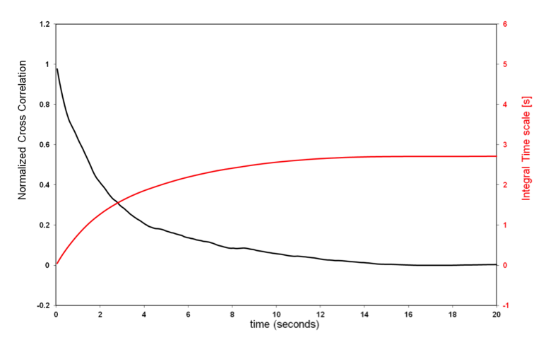
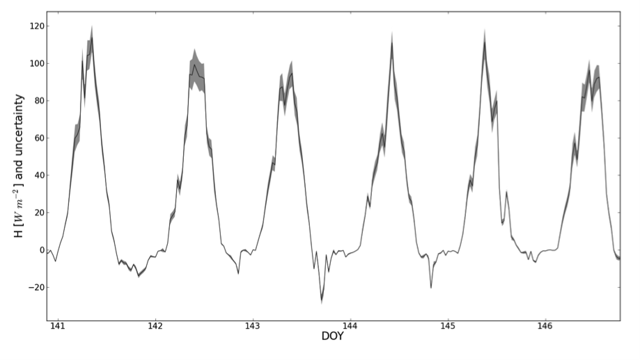
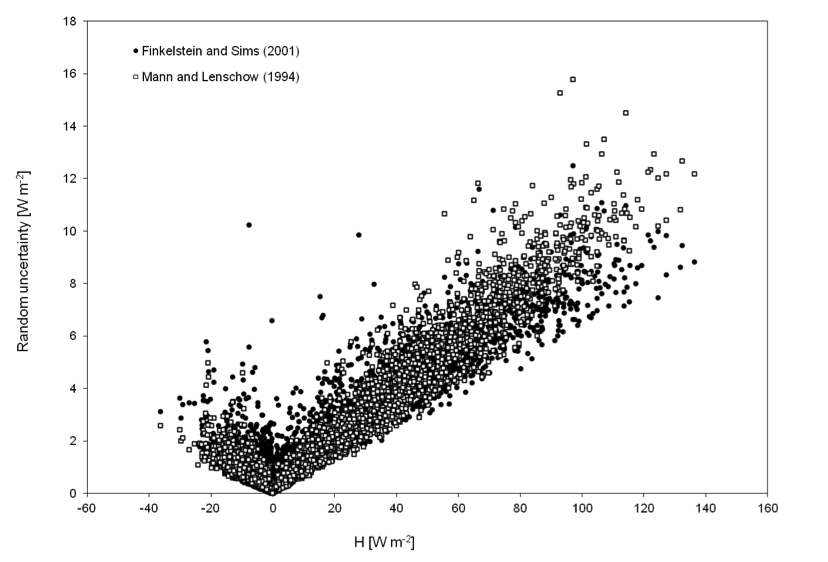

# Random uncertainty estimation

EddyFlow offers five methods for estimating the random uncertainty of a flux, selected with the **Method** dropdown on the Statistical Analysis page (project-file key `ru_meth`):

| Label in the dropdown | `ru_meth` | What it estimates |
| --- | --- | --- |
| Finkelstein and Sims (2001) | 1 | Sampling error (variance of the covariance) |
| Mann and Lenschow (1994) | 2 | Sampling error (error variance of the central moment) |
| Billesbach (2011) | 4 | Noise floor from random shuffling |
| Lenschow et al. (2000) - instrument noise | 5 | The analyser's own white noise |
| Limit of detection (Langford et al. 2015) | 6 | Total random error from the far-lag cross-covariance, and the limit of detection |

The value 3 is the Mahrt (1998) estimate, which is not offered in the dropdown. The methods answer different questions and are not interchangeable. The two sampling errors tell how much the flux would differ for another realisation of the same turbulence. The Billesbach floor tells whether a flux is distinguishable from zero. The instrument-noise estimate tells how much of the signal is the analyser's own noise, and is the smallest of them. The Langford estimate is the total random error, sampling and instrument noise together, and gives a limit of detection with it. The sampling-error methods are described first; the others follow.

## Spectral correction of the random uncertainty

**Exact UI label:** Spectrally correct the random uncertainty (checkbox below the method settings). Project-file key: `ru_spec_corr` in `[Project]`; 0 = off (the default), 1 = on. A project saved before this option existed has no key, and gets it **off**. Off is the default because EddyPro reports the random uncertainty of the uncorrected covariance, and EddyFlow's defaults reproduce EddyPro's outputs.

Every method below estimates the random error of the covariance as it was measured, before any correction. The flux reported beside it, however, has been through the spectral (band-pass) correction, which multiplies the measured flux by a correction factor to restore the high- and low-frequency contributions the measuring system attenuated (see [Spectral corrections](spectral-corrections.md)). An uncorrected random error therefore understates the uncertainty of the corrected flux by the same factor. [Langford et al. (2015)](references.md#Langford2015) recommend that any correction applied to the calculated fluxes, such as the low- and high-frequency loss corrections, should also be applied to the random error.

With the option checked, EddyFlow reports each random error multiplied by the spectral correction factor of its own flux:

    σ_F,reported = SCF_F · σ_F

where SCFF is the same factor the flux F was multiplied by: that of the w-u covariance for Tau, of w-Ts for H, of the designated hygrometer for LE and ET, and of each gas for its own flux. The factors are the ones written as the spectral correction factor columns of the [full output](output-files-full-output.md#top). It applies to every random uncertainty method, and the limit of detection of the [Langford et al. (2015) method](#far-lag-cross-covariance-and-limit-of-detection-langford-et-al-2015), α · σF,reported, follows. The CEC significance test compares the corrected flux with the corrected random error.

Only the spectral correction is applied. The density (WPL) and sonic-temperature corrections are not single factors on the flux: they add terms computed from other covariances, whose random errors are not estimated, so they are not carried over. The [flux detection limit](flux-detection-limit.md) (`<gas>_detlim`) is not affected either: it stays in uncorrected covariance units.

!!! note

    Checking the option makes every random error larger by the spectral correction factor of its flux: a few percent where the attenuation is small (1-4 % in the regression data), more where it is strong, as for water vapour in a long closed-path tube. Left unchecked, the random errors are those EddyPro reports.

## Sampling errors: Mann and Lenschow (1994) and Finkelstein and Sims (2001)

The methods of [Mann and Lenschow (1994)](references.md#Mann) and [Finkelstein and Sims (2001)](references.md#Finkelstein) require the preliminary estimation of the Integral Turbulence time-Scale (ITS), which – for our purposes – can be defined as the integral of the cross-correlation function. The cross-correlation function is given by:

6‑2
                                                            

where w is the vertical wind component, c is any scalar of interest (e.g., temperature, gas concentration, etc.), t is time and Ï" is the lag-time between the two time series. For Ï"=0 the cross-correlation function provides the covariance of w and c; as Ï" attains values > 0 the cross-correlation function typically decreases towards values close to zero, representing an increasing non-correlation as Ï" increases (black line in [Figure 6?13](#CrossCorrelation)).

                                                            Figure 6‑13. Normalized cross correlation and integral time scale over time.

The following integral represents the ITS:

6‑3
                                                            

The red line in the figure above represents the integral for any given value of the upper limit, which is theoretically set to infinity. In practical implementations, however, this integral must be stopped at a finite upper limit, which should be defined in such a way that the ITS represents the maximum correlation time of the two time series. EddyFlow provides three possible ways of defining this upper limit:

**Cross-correlation first crossing 1/e:** The integral is stopped as soon as the cross-correlation function (which always starts at 1 for Ï"=0) attains the value of 0.369. This gives the "shortest", least conservative definition of the ITS. However, it provides the fastest execution and, more importantly, assures that a value of the ITS is virtually always found based on this definition. Furthermore, it provides the most consistent assessment of the ITS across different runs, because the shape of the cross-correlation function tends to be pretty consistent and similar to the one shown in the figure, for small values of Ï".

**Cross-correlation first crossing 0:** The integral is stopped as soon as the cross-correlation function (which always starts at 1 for Ï"=0) crosses the x-axis. This definition provides a more conservative definition of ITS than the previous one, and is still "data-derived", i.e. it is not imposed by the user. The shortcoming with this definition is that the cross-correlation function may never cross the x-axis (in which case, EddyFlow switches to the next definition); also when it does, the point in which it occurs may be somewhat random, as the cross-correlation function may vary erratically for large values of Ï".

**Integrate over the whole correlation period:** The integral is stopped when Ï" reaches the value defined in the field **Maximum correlation period**, set by the user. This definition provides a conservative estimation but being imposed *a priori*, it does not assure that the cross-correlation function is actually close to zero at the upper integration limit. Also, the execution time may get longer with this choice, because the upper integration limit may be set arbitrarily high.

Once the ITS is calculated, the random uncertainty can be estimated. The random uncertainty of flux F, indicated with σF, is expressed in EddyFlow as "absolute uncertainty", and takes the same units of the flux it refers to. The approach of [Mann and Lenschow (1994)](references.md#Mann) uses the following simple equation:

6‑4
                                                            

where rwc is correlation coefficient of w and c and T is the flux averaging interval.

The approach of [Finkelstein and Sims (2001)](references.md#Finkelstein), instead, is based on the calculation of the "variance of covariance" (their Eq. 8):

6‑5
                                                            

with ɣw,w(p), ɣc,c(p), ɣw,c, and ɣc,w(p) and given by Eq. 9 and 10 in the referenced paper, n is the number of samples in the flux averaging interval and m the discrete counterpart of the ITS (m = ITS * acquisition frequency).

The following figures exemplify the random uncertainty calculated for sensible heat fluxes:

## Random shuffle: Billesbach (2011)

**Exact UI label:** Billesbach (2011). Project-file key: `ru_meth=4`. Method after [Billesbach (2011)](references.md#Billesbach1).

**Idea.** Reordering a scalar at random destroys every real correlation with the vertical wind. Whatever covariance remains after the shuffle was produced by noise alone, so its magnitude is a floor below which a flux cannot be told from zero.

**Procedure.** For each period and each flux variable (momentum, sensible heat and every configured gas), the scalar series is shuffled at random 20 times; each time the covariance with the unshuffled vertical wind is computed at zero lag. The reported value is the mean of the 20 absolute covariances. The scalar is shuffled separately for each gas and each repetition, so the estimates of different gases are independent draws. The random generator is seeded once at the start of the run with a fixed seed, so a rerun with the same data gives the same numbers. No integral turbulence time-scale is computed for this method, and the ITS settings of the page do not apply to it.

**What it means.** This is a noise floor, not a sampling error. It answers whether a flux is resolvable, not how uncertain it is, and it is systematically smaller than the two sampling errors above. Because it is the mean of absolute values rather than a standard deviation, it is about 0.8 of the scatter of the shuffled covariances. It is most useful for weak-flux species such as carbonyl sulfide or nitrous oxide, where the question is whether a flux has been detected at all. It is related to, but computed differently from, the [flux detection limit](flux-detection-limit.md#top), which measures the scatter of the cross-covariance function away from its peak.

## Instrument noise: Lenschow et al. (2000), as applied by Mauder et al. (2013)

**Exact UI label:** Lenschow et al. (2000) - instrument noise. Project-file key: `ru_meth=5`. Method after [Lenschow et al. (2000)](references.md#Lenschow) and [Mauder et al. (2013)](references.md#Mauder2013).

**Idea.** The two sampling-error methods ask how much the covariance of *w* and *c* would differ if it could be recomputed from a different, statistically equivalent realization of the same turbulent flow. This method asks a different question: how much of the measured variance is white noise contributed by the analyser itself, rather than a sampling limitation of the atmospheric signal. True atmospheric turbulence is correlated over short lags, whereas instrumental noise is not, so the autocovariance function of a noisy variable is smooth for lags of one sample and above but shows a discontinuity at lag zero, where the variance is inflated by the noise.

**Procedure.** For w and for each scalar:

1. The autocovariance is calculated at lags 0 to 5 samples.
2. A straight line is fitted through the values at lags 1 to 5 and extrapolated back to lag 0.
3. The noise variance is the measured lag-0 value minus the extrapolated value.
4. The reported uncertainty of the flux is the square root of (the scalar's noise variance multiplied by the total variance of w, divided by the number of samples). The noise variance of w is used only as a validity check.

The five-lag window is fixed in samples and is not derived from the acquisition frequency, so it spans 0.1 to 0.5 s at 10 Hz and half as long at 20 Hz.

!!! note

    The method declines a period rather than guessing. If the noise variance of either w or the scalar is not positive, which means that the extrapolated line sits at or above the measured lag-0 value, the assumption on which the method rests does not hold in that period and the estimate is reported as missing. On a low-noise analyser this can happen in most periods, which is itself informative.

**What it means.** The result is the analyser's own noise and is the smallest of the four estimates. It says nothing about whether the atmosphere was sampled long enough (the sampling errors) or whether a flux is resolvable (the Billesbach floor). It can also be used as one of the noise floors for borrowing time lags from another gas on the same analyser; see [Raw processing options](raw-processing-options.md#top) and [Detecting and compensating time lags](time-lag-detect-correct.md).

## Far-lag cross-covariance and limit of detection: Langford et al. (2015)

**Exact UI label:** Limit of detection (Langford et al. 2015). Project-file key: `ru_meth=6`. Method after [Langford et al. (2015)](references.md#Langford2015), Sect. 2.2, which builds on the detection limit of [Wienhold et al. (1994)](references.md#Wienhold1994) and [Spirig et al. (2005)](references.md#Spirig2005). [Maier et al. (2022)](references.md#Maier2022) applied it to N2O and CH4 fluxes; this method offers it for every flux. Its settings are under **Settings...** beside the method; see [Limit of detection settings](limit-of-detection-settings.md#top).

**Idea.** The flux is the covariance of the vertical wind *w* and a scalar *c* at the transport lag. Computed at every lag *Δ*, the same quantity is the cross-covariance function

    f(Δ) = mean over k of  w'(k) · c'(k + Δ)

which has a peak at the transport lag. Several integral time scales away from it, *w* and *c* are no longer correlated ([Spirig et al., 2005](references.md#Spirig2005)), so a true flux cannot show up there. Whatever *f* still does at those lags is what a finite record of noisy data produces when there is no flux: the analyser's noise plus the chance correlation of turbulence sampled for only one averaging period. Its spread is therefore an estimate of the random error of the covariance at the peak ([Wienhold et al., 1994](references.md#Wienhold1994); [Langford et al., 2015](references.md#Langford2015)). Unlike the [instrument-noise estimate](#instrument-noise-lenschow-et-al-2000-as-applied-by-mauder-et-al-2013), it contains both sources, and unlike the [two sampling errors](#sampling-errors-mann-and-lenschow-1994-and-finkelstein-and-sims-2001), it needs no model of the turbulence statistics.

**Main equations.** Over the *N* lags of the far-lag region (two windows, one either side of the lag, pooled):

    RE_SD   = σ_f = sqrt( (1/N) Σ (f(Δ) − μ_f)² )
    RE_RMSE = sqrt( (1/N) Σ f(Δ)² ) = sqrt( σ_f² + μ_f² )        (Langford et al. 2015, Eq. 9)
    LoD     = α · RE                                                (α = 1.96 for 95 %, 3 for 99 %)

where *μf* and *σf* are the mean and standard deviation of *f* in the windows. RESD measures how much *f* scatters; RERMSE also counts how far it sits from zero. A trend in the scalar, or structures that persist longer than the averaging period, keep *f* on one side of zero over wide ranges of lag. The standard deviation then misses that offset, and many lags of the function lie above a limit derived from it ([Langford et al., 2015](references.md#Langford2015), Fig. 2). Langford et al. therefore use RERMSE, and it is the default here; RESD can be chosen instead. They also show that the limit depends on the detrending (block averaging gave clearly higher limits than linear detrending in their example), which is why EddyFlow measures it on the same detrended, time-lag-aligned series the flux is computed from.

A flux whose magnitude is below the LoD is not significantly different from zero at the chosen confidence level. It should not be discarded for that reason alone: [Langford et al. (2015)](references.md#Langford2015) recommend reporting it together with its random error, because averaging many fluxes lowers the detection limit. For the mean of *n* fluxes, the limit of the ensemble is

    LoD_ensemble = (1/n) · sqrt( Σ LoD_i² )

so a set of individually undetectable fluxes can still give a significant mean, provided the time lag is not chosen by maximising each noisy covariance, which biases weak fluxes away from zero. For weak-flux gases, see the time-lag borrowing in [Detecting and compensating time lags](time-lag-detect-correct.md).

**Lag windows.** In seconds either side of the lag the flux uses:

| Option | Window | Source |
| --- | --- | --- |
| ±150–180 s (Langford et al. 2015) | 150 to 180 s | The region used by [Langford et al. (2015)](references.md#Langford2015), Sect. 2.2 (the default) |
| ±160–180 s (Maier et al. 2022) | 160 to 180 s | The region of [Spirig et al. (2005)](references.md#Spirig2005), as used by [Maier et al. (2022)](references.md#Maier2022) |
| Automatic (multiple of the integral turbulence scale, after Spirig et al. 2005) | from max(k · ITS, lag search half-width + 10 s), 30 s wide | See below |

[Spirig et al. (2005)](references.md#Spirig2005) placed their window where it lay "several times the integral timescale" from the lag, and [Langford et al. (2015)](references.md#Langford2015) mention a multiple of the integral time scale as an alternative to fixed bounds. Neither gives a rule, so **the automatic rule is EddyFlow's own**: the window starts at *k* times the integral turbulence scale (ITS, computed per period and variable with the **Definition of the ITS** and **Maximum correlation period** above; *k* = 10 by default), or 10 s beyond the half-width of the variable's time-lag search range, whichever is later, and is 30 s wide. The second condition keeps the true peak, and any uncertainty in where it is, outside the window. Where the ITS cannot be measured, the 150–180 s window is used. The chosen window is written to the run log. In any mode, a window that would leave less than half the record behind each lag is shortened, and a variable whose window no longer fits is reported as missing; this matters only for very short averaging periods.

**Units and outputs.** The random error is converted from covariance to flux units exactly as the flux is (for example with ρcp for H and λ for LE), and is reported for Tau, H, LE, ET and every configured gas as `rand_err_*` in the [full output](output-files-full-output.md#top) and `*_RANDUNC_HF` in the FLUXNET file. The limit of detection α · RE is reported as `lod_*` in the full output (only with this method) and as `*_LOD` in the FLUXNET file (error-labelled with any other method). As [Langford et al. (2015)](references.md#Langford2015) recommend, both are multiplied by the flux's spectral correction factor when **Spectrally correct the random uncertainty** is checked (off by default, as in EddyPro); see [Spectral correction of the random uncertainty](#spectral-correction-of-the-random-uncertainty).

**Relation to the flux detection limit.** The same calculation can also be chosen as the [flux detection limit](flux-detection-limit.md#top) (`detlim_meth=2`), with the same settings. There it is measured on the raw series about each gas's own lag, before the lag is applied, because [time-lag borrowing](time-lag-detect-correct.md) tests a gas's covariance against it at that stage, and it is reported in covariance units as `<gas>_detlim`.
