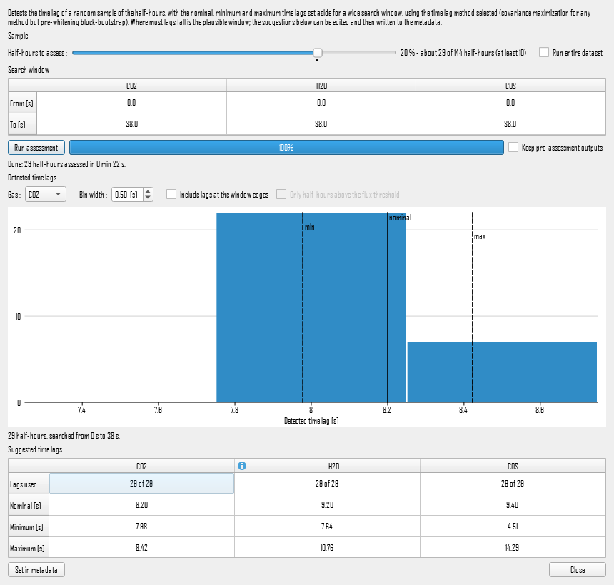

# Timelag preliminary assessment

Under: Advanced Settings > Processing Options > Time lags compensation > Timelag preliminary assessment...

Before processing, you have to tell EddyFlow where to look for each gas's time lag: a **Nominal time lag** and a window between a **Minimum** and a **Maximum time lag**, per column of the metadata (see [Nominal, minimal, and maximum time lag](nominal-time-lag.md#top)). A window that misses the real lag pins covariance maximization or PWB to its edge, or makes the run fall back to the nominal value. The preliminary assessment finds out where the lags actually are first. It detects the time lag of a random sample of the half-hours, or of all of them, over a wide search window that ignores the nominal, minimum and maximum lags already set. It then shows, gas by gas, where the detected lags fall, suggests a nominal lag and a window, and writes them to the metadata on request.

The assessment detects lags with the method selected under **Time lag detection method**: with **Pre-whitening block-bootstrap**, by PWB (see [Pre-whitening block-bootstrap](time-lag-detect-correct.md#pre-whitening-block-bootstrap-pwb)); with any other method, by covariance maximization over the search window, with the project's covariance options (maximized variable, stochastic detrending, baseline subtraction). The button is available whenever **Time lags compensation** is ticked.

!!! note

    The assessment needs raw data. If no raw data folder is set on the Basic Settings page, the folder does not exist, or it holds no raw files of the project's type, the button says so instead of opening the dialog. A raw data folder given as a Google Drive or Dropbox shared link is accepted; its files are listed when the run starts.

## Sample

- **Half-hours to assess:** A slider for the share of the half-hours with raw data that are drawn at random and assessed, on a log scale from 0.1 % to 100 %: each tenfold step takes the same travel. The label beside it gives the share and about how many half-hours that is. At least **10** half-hours are always drawn, however small the share.
- **Default:** The slider opens at a default that depends on the size of the dataset, marked by a small triangle under the slider; double-click the slider to return to it. The default is only a starting point, and any share can be chosen.

    | Dataset | Half-hours | Default share | Half-hours assessed |
    |---|---|---|---|
    | 1 day | 48 | 20 % | 10 (the minimum) |
    | 3 days | 144 | 20 % | 29 |
    | 1 week | 336 | 20 % | 67 |
    | 2 weeks | 672 | 17.3 % | 116 |
    | 1 month | 1440 | 10 % | 144 |
    | 3 months | 4380 | 4.5 % | 197 |
    | 1 year | 17520 | 1.6 % | 280 |
    | 2 years or more | 35040 or more | 1 % | 350 or more |

    The default is 20 % for a dataset of up to about 11 days, 10 % for a month, and falls slowly after that, as 10 % × (1440 / half-hours)0.72, to 1 % from two years on. The share shrinks as the dataset grows while the number of half-hours assessed still rises slowly.

- **Run entire dataset:** Assess every half-hour with raw data instead of a sample. The slider moves to 100 % and is locked; unticking the box returns it to where it was. A run over the entire dataset takes as long as the time lag pre-pass of a full run, and it is one. See [Using the result as the project's time lag file](#using-the-result-as-the-projects-time-lag-file).

The sample is drawn from the whole raw data folder, not from the project's processing period (**Select a different period** on the Basic Settings page), so that a short processing period can still be assessed against all the data available.

## Search window

A table with one column per gas of the project and two rows, **From [s]** and **To [s]**: the lags searched for that gas. Double-click a cell to edit it. The heading's tooltip says whether the gas is measured by a closed-path or an open-path analyser and, for a closed path, the transit time of its intake tube.

The window opens wide, so that the real lag is inside it whatever the metadata says:

- **Open path:** from −5 s to +5 s.
- **Closed path:** from 0 s to three times the tube transit time plus 10 s, rounded up. The transit time is the tube's volume divided by its flow rate, from the analyser's tube length, inner diameter and flow rate in the metadata, as EddyFlow derives a default lag. Where the tube is not described, 0 s to 30 s.

A wider window costs processing time, and with PWB it also lengthens the bootstrap blocks (see **Block length** in [PWB time lag optimization settings dialog](pwb-time-lag-settings.md#bootstrap-and-reliability)). If many lags come out at an edge of the window, widen it and run again.

## Running the assessment

- **Run pre-assessment:** Start the assessment. While it runs the button reads **Cancel** and stops it, the sample and the search windows cannot be changed, and the main window waits. A progress bar shows how many of the drawn half-hours are done and about how long is left. Until the engine has listed the raw files and read the metadata, the bar shows that it is busy without a count.
- **Keep pre-assessment outputs:** See [Outputs](#outputs). Off by default.
- **Show engine output:** Appears when a run fails or detects no lag, and shows what the engine printed.

The assessment always runs split across all the processor cores, whatever the main window's **Parallelise the planar fit and time lag pre-passes** setting says (see [Advanced settings: processing options](raw-processing-options.md#parallelise-the-planar-fit-and-time-lag-pre-passes)). Its result does not depend on how the half-hours are shared out.

The engine runs on a throw-away copy of the project and of its metadata, written to a temporary folder with an engine home folder of its own. Your project and metadata files are not written, a project with unsaved changes stays unsaved (and the copy includes those changes), and a run started from the main window is not disturbed. The copy runs in advanced mode over the whole dataset as an assessment-only time lag pre-pass, without the flux correction step.

## Detected time lags

A chart of the lags found for one gas, as a histogram or as a time series:

- **Gas:** The gas shown. Clicking a gas's column in the suggestions table below shows it too.
- **Bin width:** The width of each bar of the histogram, in seconds (default 0.5 s). Not used by the time series.
- **View:**
    - **Histogram** (the default): how many half-hours found each lag. This is where the suggestion comes from.
    - **Time series:** one dot per half-hour at its lag, against the end of its averaging period, with the suggested nominal lag and window as horizontal lines. It shows what the histogram cannot: whether the lag drifts, jumps (for instance after a change of tube or flow), or follows the time of day, as a lag that is well defined by day and scattered at night, when the flux is weak, often does. The times are shown as in the raw files, with no daylight-saving shift.
- **Include lags at the window edges:** A lag at either end of the search window is where the covariance was still rising, not a peak. Such lags are always drawn, stacked in grey on top of the others; ticked, they also count towards the suggestions. Unticked by default.
- **Only half-hours above the flux threshold:** Use only the half-hours whose flux cleared the minimum flux of the automatic time lag optimization (`gas_<i>_to_min_flux`, and `to_le_min_flux` for water vapor, set in the [Time lag optimization settings](time-lag-detect-correct.md#automatic-time-lag-optimization)). A weak flux gives a poorly defined lag, but the threshold is compared with the signed flux, so for a gas that is mostly taken up rather than emitted it may drop every half-hour. Unticked by default, and not available with PWB, which judges each detection itself.

Lines mark the suggested **nominal** lag (solid) and the **min** and **max** of the window (dashed), vertical in the histogram and horizontal in the time series. They follow any edit to the suggestions. Below the chart, a line gives how many half-hours are shown, the window searched and, if any, how many lags fell at a window edge.

## Suggested time lags

A table with one column per gas and five rows:

- **Lags used:** How many lags the suggestion is made from, out of all those detected for the gas. "(peak)" marks a count of the lags around the peak (see below).
- **Nominal [s]:** The median of the lags around the peak.
- **Minimum [s]** and **Maximum [s]:** That median minus and plus `to_pg_range` robust standard deviations of the same lags. The robust standard deviation is the median absolute deviation divided by 0.6745, never taken as less than 0.1 s. This is the rule the [automatic time lag optimization](time-lag-detect-correct.md#time-lag-optimization-for-passive-gases) uses for passive gases, with its **Plausibility range around median value** setting (`to_pg_range`, 1.5 by default). For a closed path the minimum is never below 0 s, and neither value goes outside the window searched.
- **Same analyser:** A **Borrow from &lt;gas&gt;** button, where the gas may take another gas's suggestion (see [Borrowing from a gas on the same analyser](#borrowing-from-a-gas-on-the-same-analyser)); otherwise "-".

Double-click a value to edit it before setting it in the metadata.

### Taken from the peak, not from every lag

The suggestion is taken from the **peak** of the detected lags, not from all of them. A gas with a weak flux, a trace gas especially, finds its real lag in only some of the half-hours. In the rest, covariance maximization returns a lag anywhere in the search window. The median of all the lags then lands in the middle of the window, far from the peak plainly visible in the chart, and their spread gives a window nearly as wide as the one searched. So the suggestion is built in three steps:

1. **The peak:** the highest point of the lags' density, each lag counted as a small bell curve 0.3 s wide.
2. **The lags around it:** first those within 2 s of the peak. Then, until the set stops changing, those within three robust standard deviations (but at least 0.5 s) of the set's median.
3. **The suggestion:** the median and window above, from those lags only.

For a gas whose lags nearly all sit in one peak, this gives the same answer as using every lag.

A peak is **clear** when it holds at least 5 lags and at least three times as many as an even spread over the search window would put in its width.

### Remarks

A gas with a remark shows an icon in its column heading: a warning sign for a remark that calls the suggestion into question, an information sign otherwise. Hover anywhere over the column to read it. The remarks are:

- **Peak at &lt;lag&gt; s, found by &lt;n&gt; of &lt;total&gt; half-hours (&lt;share&gt; %); the rest are scattered over the search window:** A clear peak, but held by fewer than half the lags. The suggestion is taken from it.
- **No clear peak: the lags spread over the search window:** The values, where there are any, are not to be trusted without a look at the chart.
- **Too few usable lags:** Fewer than 5 lags in the peak, and the column holds no values.
- **Not detected in any half-hour.**
- **Water vapor:** Its lag grows with relative humidity, so a single window is a compromise. The automatic time lag optimization handles this with humidity classes (see [Time lag optimization for water vapor](time-lag-detect-correct.md#time-lag-optimization-for-water-vapor)).
- **Borrowed from &lt;gas&gt; on the same analyser.**

Where a gas has a minority peak, no clear peak or too few lags, the remark also gives the lag of the gas on the same analyser with the clearest peak, if there is one, and how many of its half-hours found it. For example: "CO2 (miro_mga4_6_2) on the same analyser: 8.00 s (95 % of its half-hours)".

### Borrowing from a gas on the same analyser

Gases measured by one analyser are drawn through the same intake tube, so they share its time lag. When a gas has no clear peak of its own, or too few lags, and a gas on the same analyser has a clear one, the **Same analyser** row offers **Borrow from &lt;gas&gt;**. Clicking it copies that gas's nominal, minimum and maximum lag, as they stand in the table including any edits, into this gas's column. The chart then shows the borrowed values over this gas's own lags. The button turns into **Use own suggestion**, which puts this gas's own values back.

Typically a trace gas borrows from the CO2 of the same laser analyser, for instance COS or N2O from a MIRO's CO2.

A gas borrows only from a gas:

- on the **same analyser**, as named in the gas's record on the Basic Settings page; a gas whose analyser is not known neither lends nor borrows
- that is **not water vapor**, because water's lag depends on humidity in a way the other gases' does not; water vapor does not borrow either
- with a **clear peak** of its own, not itself borrowed

If several gases qualify, the one whose peak holds the largest share of its lags is offered. These are the same rules by which PWB lends a lag between gases during processing (see [PWB time lag optimization settings dialog](pwb-time-lag-settings.md#top)).

Running the assessment again, or changing **Include lags at the window edges** or **Only half-hours above the flux threshold**, recomputes every suggestion and undoes any borrowing.

## Set in metadata

Writes each gas's nominal, minimum and maximum lag, as they stand in the table, to that gas's column in the metadata (`col_<N>_nom_timelag`, `col_<N>_min_timelag`, `col_<N>_max_timelag`). The metadata is then saved as after any other edit. Gases without a suggestion are left as they are. A summary says what was written where, and which values were borrowed from which gas.

What else changes depends on the time lag detection method:

- **Automatic time lag optimization** and **Pre-whitening block-bootstrap** search windows of their own (`gas_<i>_to_min_lag` / `gas_<i>_to_max_lag`, `gas_<i>_pwb_min_lag` / `gas_<i>_pwb_max_lag`), which would otherwise go on overriding the metadata. The minimum and maximum also become that window, rounded outwards to 0.1 s.
- **Covariance maximization** and **Covariance maximization with default** read the metadata directly.
- **Constant** uses only the nominal lag.

If the project reads its metadata from the raw files (GHG files without an alternative metadata file), the metadata is not changed; only the methods' own windows are.

If the project reads the PWB time lag table of an earlier entire-dataset assessment (see below), you are asked first. That table was detected with the search window, and the engine refuses a PWB table whose windows differ from the project's, stopping with "PWB time-lag file was written under different PWB settings". Answer **Yes** to set the suggested windows and have the project detect its lags itself again. Answer **No** to write the metadata only and keep using the table.

## Using the result as the project's time lag file

A run over the entire dataset is a time lag pre-pass like any other. Whether or not the outputs are kept, it leaves in the project's output folder the file that pre-pass leaves:

- **Covariance-based methods:** the time lag optimization results (`<id>_timelag_opt_<timestamp>.txt`), with the project's water vapor humidity classes.
- **Pre-whitening block-bootstrap:** the half-hourly PWB time lag table (`<id>_pwb_timelag_<timestamp>.csv`) and its aggregate summary (`<id>_pwb_timelag_opt_<timestamp>.txt`).

With **Automatic time lag optimization** or **Pre-whitening block-bootstrap** selected, the **Use time lag file in project** button then appears. It sets the project to **Time-lag file available** (`to_mode=0`) and selects the file (`to_file`), so the project's run reads its time lags from it instead of repeating the pre-pass. Under PWB, where the file is the half-hourly table, the project's PWB search windows are also set to the windows searched, the ones the table was detected with, since the engine accepts the table only under those. The other methods do not read such a file, so the button does not appear for them.

The file reflects the wide search windows of the assessment, not the narrower windows you may set afterwards. Under the automatic optimization that is what the pre-pass is for. Under PWB, see the question described in [Set in metadata](#set-in-metadata).

## Outputs

The assessment's outputs are written to its temporary folder and removed when the dialog closes, unless **Keep pre-assessment outputs** is ticked. Then the folder is copied to `tlag_preassessment_<yyyyMMdd-HHmm>` in the project's output folder, or beside the project file if the output folder is not a local folder. The copy is refreshed when the dialog closes, so the charts and suggestions saved are the ones you ended with. It holds:

- `<gas>_timelag_histogram.png` and `<gas>_timelag_timeseries.png`: each gas's chart in both views, whichever is shown in the dialog, with the same bins, options and suggestion, in light colors whatever the interface's theme.
- `suggested_timelags.csv`: one row per gas with the lags used, the share of the gas's lags in its peak (`peak_share`), the nominal, minimum and maximum lags, the gas they were borrowed from if any (`borrowed_from`), and the remark.
- `out/<id>_tlag_preassess_<timestamp>.csv`: every lag detected, one row per half-hour and gas, with the columns `date`, `time`, `gas`, `gas_record` (the project's `gas_<i>` record), `method` (`maxcov` or `pwb`), `detected_lag_s`, `window_min_s`, `window_max_s`, `at_edge`, `flux` and `flux_ok`. The lags are taken before the automatic optimization's flux and window-edge filters drop anything. Under PWB the lag is each half-hour's own detection, before any gap-filling, and the flux columns are empty.
- `out/`: the rest of the engine's output, among them the time lag optimization file and the run log.
- `preassess.<ext>` and `preassess.metadata`: the copies of the project and metadata the engine ran on.
- `home/`: the engine's working folder.

## Project-file keys

The assessment adds four keys to the copy of the project it runs, in `[RawProcess_TimelagOptimization_Settings]`. They are never written to your project. They are listed here for running the engine by hand:

- `to_sample_frac`: Share of the half-hours with raw data to walk, from 0 to 1. Absent or 0, every half-hour is walked.
- `to_sample_min_n`: The fewest half-hours drawn (default 10).
- `to_sample_seed`: Seed of the random draw. The same seed draws the same half-hours, serial or split across workers.
- `to_dump_lags`: `1` writes `<id>_tlag_preassess_<timestamp>.csv`.

They act only in an on-the-fly time lag pre-pass (`to_mode=1` with `tlag_meth` 4 or 5). With `tlag_assessment_only=1` the run stops after the pre-pass.

## Dialog buttons

- **Set in metadata:** See [Set in metadata](#set-in-metadata).
- **Use time lag file in project:** See [Using the result as the project's time lag file](#using-the-result-as-the-projects-time-lag-file).
- **Close:** Close the dialog. A running assessment is stopped first, after you confirm. The outputs are removed unless kept.
